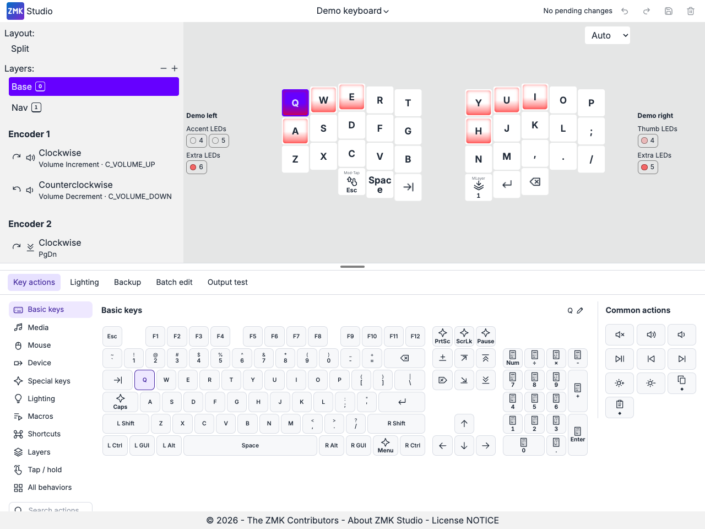
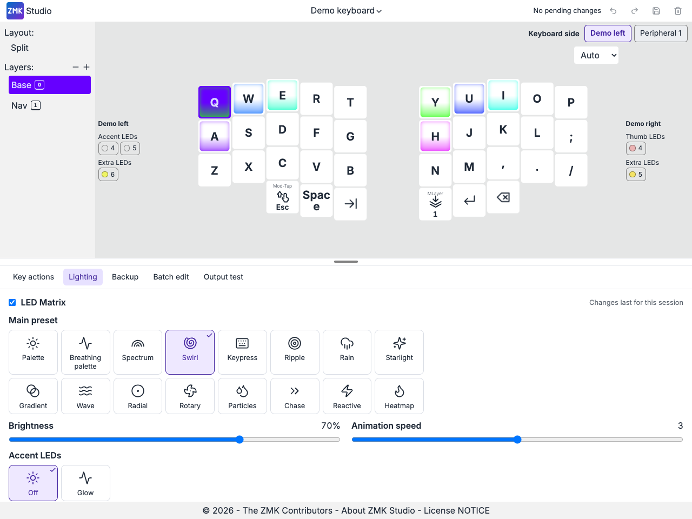

# ZMK Studio (afayge edition)

Remap keys and back up bindings on a ZMK keyboard. This edition also includes an LED matrix editor for keyboards running compatible firmware. To explore both editors without connecting hardware, choose **Try a demo keyboard** on the welcome screen.



## Download and install

The desktop app version is **0.4.0**. Look for **v0.4.0-afayge.1** on the [Releases page](https://github.com/afayge/zmk-studio/releases). When the release is published, open **Assets** and choose the file for your system.

| System | File | Installation |
| --- | --- | --- |
| macOS, Apple Silicon or Intel | `ZMK-Studio-macOS-universal.dmg` | Open the disk image and drag **ZMK Studio** to **Applications**. |
| Windows, Intel or AMD x64 | `ZMK-Studio-Windows-x64-setup.exe` | Run the installer and follow the prompts. |
| Linux, x64 | `ZMK-Studio-Linux-x64.AppImage` or `ZMK-Studio-Linux-x64.deb` | Make the AppImage executable and open it. On Debian or Ubuntu, you can instead run `sudo apt install ./ZMK-Studio-Linux-x64.deb`. |
| Linux, ARM64 | `ZMK-Studio-Linux-arm64.AppImage` or `ZMK-Studio-Linux-arm64.deb` | Make the AppImage executable and open it, or install the Debian package with `sudo apt install ./ZMK-Studio-Linux-arm64.deb`. |

The macOS app uses an ad hoc signature and has no Apple notarization. The Windows installer is unsigned. To verify a download, compare its hash with the entry for that filename in the release's `SHA256SUMS.txt`. Use `shasum -a 256 <file>` on macOS, `Get-FileHash <file> -Algorithm SHA256` in PowerShell, or `sha256sum <file>` on Linux. Replace `<file>` with the downloaded filename.

## Firmware compatibility

**Standard key remapping works with compatible keyboards running Studio-enabled ZMK firmware.** To edit lighting on a physical keyboard, use a firmware build for your specific board that implements the Studio lighting protocol extension. The public `afayge/zmk` commit checked for this release, `e0603e4`, lacks that extension. Flashing that revision alone will not enable the lighting editor. [Companion firmware repository](https://github.com/afayge/zmk) · [Checked firmware revision](https://github.com/afayge/zmk/tree/e0603e4faac832f9d215f6008a4cee8ee6206b6c)

| Feature | What your keyboard needs |
| --- | --- |
| Remap keys across layers, batch edit, or back up bindings | Standard ZMK Studio support and an unlocked keyboard. The firmware supplies the list of available behaviors. |
| Bind a key to toggle matrix lighting, change brightness, or cycle effects | Firmware that exposes the corresponding LED Matrix behavior and command. |
| Edit presets, zones, indicators, or per-LED colors in **Lighting** | Compatible LED hardware, the lighting protocol extension, and the feature enabled for your board. On a split keyboard, the side you edit must be online and support the operation. |
| Remap an encoder's clockwise or counterclockwise action | Firmware that reports the encoder and supports editing its directional bindings. |

On a supported keyboard, open **Lighting**, select the side and LED group, adjust its settings, and click **Apply** in that group. You can also try this sequence with the demo keyboard.



## Remap your first key

1. **Connect.** Plug in your keyboard with a USB data cable, open Studio, and select the device labeled **USB**. Use **Refresh devices** if you just plugged it in. Select **BLE** for a wireless connection if your firmware supports Studio over Bluetooth.
2. **Unlock.** When **Unlock To Continue** appears, press the physical key or combo assigned to `&studio_unlock` in your keyboard's keymap. The assignment varies by keyboard. [ZMK Studio unlock behavior](https://zmk.dev/docs/keymaps/behaviors/studio-unlock)
3. **Choose a binding.** Select a layer, then click the key on the keyboard diagram. Under **Key actions**, choose a key from **Basic keys** or use **Search actions** to find a behavior. For a binding with parameters, set the values and click **Apply binding**.
4. **Save and test.** Click **Save** in the toolbar and look for **Saved to keyboard**. Open **Output test**, click the test area, and press the physical key to see the key-down and key-up events received by the window.

In demo mode, **Saved in demo session** means the edit applies to the current demo session.

## Back up and restore bindings

Open **Backup** and select **Export JSON** under **Binding backup**. The resulting `zmk-keymap.json` contains the key bindings for every layer of the active physical layout. Lighting settings and the firmware image are outside the scope of this backup.

To restore, connect the same keyboard, select the matching physical layout, and choose **Preview JSON**. Review the changes for each layer, click **Apply … changes**, then click **Save**. If the preview reports a mismatch, check the device, physical layout, layer IDs and order, and available behaviors before applying the backup.

## Run from source

With Node.js 22 and npm installed, run these commands from the repository root:

```sh
npm ci
npm run dev
```

Run `npm test` for the key binding and lighting tests, or `npm run build` to build the web app. The generated TypeScript protocol files are included in the repository. To launch the desktop app in development mode, install Rust and the Tauri dependencies for your platform, then run `npm run tauri -- dev`. [Tauri prerequisites](https://v2.tauri.app/start/prerequisites/)

This edition is based on ZMK Studio. [Upstream project](https://github.com/zmkfirmware/zmk-studio) · [Apache 2.0 license](LICENSE) · [Notices](NOTICE)
